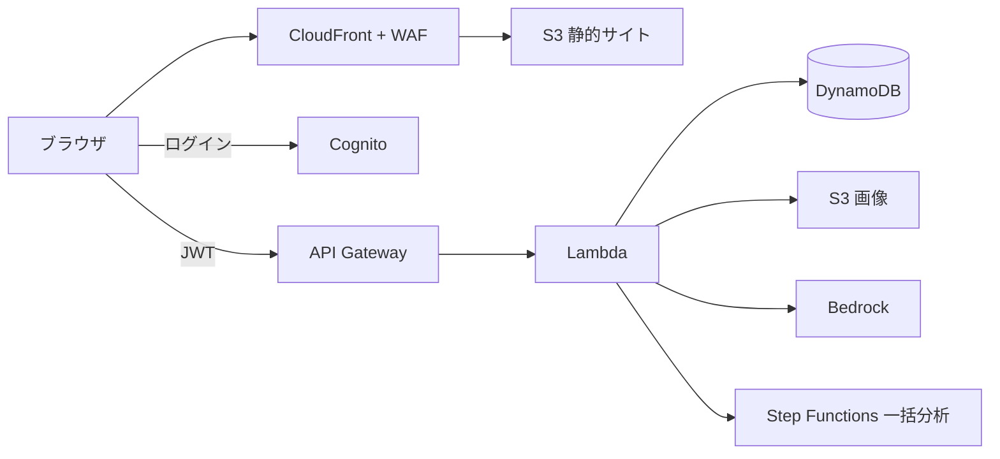

# Kith Diary Web — AWS版 設計（構想のみ・未実装）

現行は Firebase / Google Cloud。全面的に AWS に置き換えた場合の設計案。

## 対応表

| 現行（Google） | AWS版 |
|---|---|
| Firebase Hosting | S3 + CloudFront（Next.js 静的出力をそのまま配信） |
| Firebase Auth（Google ログイン / パスキー） | Amazon Cognito（Google 連携・パスキー） |
| Firestore `users/{uid}/entries`, `analyses` | DynamoDB 1テーブル：`PK=USER#uid`, `SK=ENTRY#日付#id` / `ANALYSIS#yyyy-mm` |
| Firebase Storage（画像） | S3（非公開、署名付き URL） |
| Cloud Functions `analyzeDiary` / `backfillAnalyses` | Lambda + API Gateway（Cognito JWT オーソライザ） |
| Vertex AI Gemini | Amazon Bedrock（Claude / Nova。入力は学習に使われない） |
| 一括分析（7分制限で再実行） | Step Functions / SQS で月ごとに Lambda 実行 |
| App Check / reCAPTCHA | AWS WAF（Bot Control・レート制限・CAPTCHA） |
| セキュリティログ | CloudTrail + CloudWatch Logs |

## 構成図



## 大きく変わる点

### 認可（BOLA 対策）の場所
- 現行：ブラウザ → Firestore 直接。Security Rules（`request.auth.uid == uid`）が本人限定を保証。
- AWS版：必ず API（Lambda）経由。uid は JWT の `sub` から取り、リクエスト中の `userId` は使わない。

```js
const uid = event.requestContext.authorizer.jwt.claims.sub;
// 常に PK = `USER#${uid}` で読み書きする
```

原則は同じ「本人IDは認証情報から取る」。Google版はルールに、AWS版はコードに書く。

### リアルタイム同期
Firestore の `onSnapshot`（変更のプッシュ・オフライン同期）は無くなる。必要なら AppSync サブスクリプション / WebSocket API。通常は再読込で十分。

### 検索
DynamoDB に全文検索は無い。必要なら OpenSearch 等を別途。

### IAM
Lambda ごとに専用ロール。対象テーブル・バケット・Bedrock モデルのみ許可（最小権限）。

### WAF Bot Control
- Common：自己申告ボット（UA・IP評判）を判定。
- Targeted：JS チャレンジ＋トークンで偽装ボットも検知（高コスト）。
- 個人用途はレート制限＋Common で十分。

## 移行
1. Firestore → DynamoDB、Storage → S3 の一括移行スクリプト
2. ユーザーを Cognito にインポート（パスキーは再登録）
3. DNS / Hosting 切替

## コスト・評価
- 個人利用ならほぼ無料枠。Bedrock は従量課金。
- 学習題材（IAM / Cognito / WAF）として有用。運用の手軽さは Firebase が上。
